---

### `$ cat stack.json`

  

### `$ ./stats --live`

  
  

  

### `$ ls ./projects`

  
  

| Project | What it is | Built with |
|---|---|---|
| **[FlowDesk](https://github.com/delightvgn-sketch/flowdesk)** · [live demo](https://flowdesk-lime-beta.vercel.app) | Full-stack SaaS for managing clients, projects, tasks, invoices and business operations | TypeScript · Next.js |
| **[Kenyan AI Tutor](https://github.com/delightvgn-sketch/kenyan-ai-tutor)** | AI-powered study assistant for Kenyan students | Python |

### `$ git log --graph`

  <picture>
    <source media="(prefers-color-scheme: dark)" srcset="https://raw.githubusercontent.com/delightvgn-sketch/delightvgn-sketch/output/github-contribution-grid-snake-dark.svg" />
    <source media="(prefers-color-scheme: light)" srcset="https://raw.githubusercontent.com/delightvgn-sketch/delightvgn-sketch/output/github-contribution-grid-snake.svg" />
    
  </picture>

### `$ contact --now`

  
  
  

<code>delight@github:~$ exit</code> — thanks for stopping by ✦

